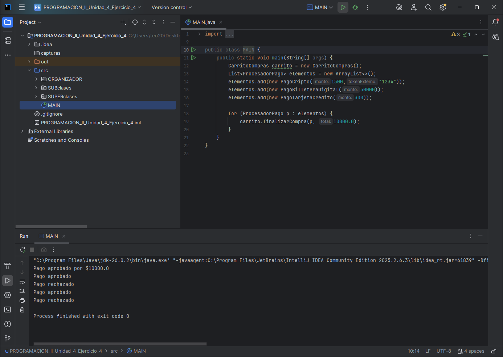

# PROGRAMACIÓN II — Unidad 4, Ejercicio 4: Pasarelas de Pago y Procesamiento Dinámico de Transacciones

Trabajo práctico de Programación II. Este repositorio contiene la resolución en Java del ejercicio 4 de la Unidad 4.

## Consigna

#### Contexto

Al momento de abonar un carrito de compras en un sitio de comercio electrónico, el sistema no debe interesarse por los protocolos bancarios internos de cada proveedor (tarjetas de crédito, criptomonedas o billeteras virtuales). Mediante el polimorfismo, el módulo de caja procesa cualquier método de pago invocando una orden universal de cobro.

#### Consigna

Modelar un sistema de pagos en Java donde el módulo de checkout interactúe polimórficamente con múltiples procesadores de transacciones monetarias.

#### Desarrollo requerido

- Definir una interfaz ProcesadorPago que declare el método boolean efectuarCobro(double monto).
- Desarrollar clases concretas como PagoTarjetaCredito, PagoCripto y PagoBilleteraDigital que implementen la interfaz anterior con validaciones de saldo o tokenización.
- Crear una clase CarritoCompras que contenga un método finalizarCompra(ProcesadorPago pasarela, double total) capaz de aceptar cualquier procesador de forma polimórfica.
- En el método main, simular compras cambiando dinámicamente la pasarela de pago utilizada y reflejar el éxito o rechazo de la transacción por consola.

## Estructura del repositorio

```
PROGRAMACION_II_Unidad_4_Ejercicio_4/
├── README.md
├── capturas/
│   └── consola.png
└── src/
    ├── ORGANIZADOR/
    │   └── CarritoCompras.java
    ├── SUBclases/
    │   ├── PagoBilleteraDigital.java
    │   ├── PagoCripto.java
    │   └── PagoTarjetaCredito.java
    ├── SUPERclases/
    │   └── ProcesadorPago.java
    └── MAIN.java   # clase con el método main
```

## Funcionamiento y lógica

El ejercicio aplica **polimorfismo** con una clase abstracta para cobrar con distintos medios de pago. Está organizado en los paquetes `SUPERclases`, `SUBclases` y `ORGANIZADOR`.

### `SUPERclases.ProcesadorPago` (clase abstracta)

Guarda un `monto` privado, que se recibe en el constructor, y declara el método abstracto `boolean efectuarCobro(double monto)`.

### `SUBclases`

- **`PagoCripto`:** guarda un token externo y lo compara con un token interno (`"1234"`) usando `==`. Como los dos son el mismo literal `"1234"`, la comparación da `true`.
- **`PagoBilleteraDigital` y `PagoTarjetaCredito`:** tienen un atributo `saldo` propio, que empieza en 0. Comparan ese saldo con el monto del cobro: muestran un mensaje según la comparación `saldo < monto` y devuelven `!(saldo < monto)`.

### `ORGANIZADOR.CarritoCompras`

Su método `finalizarCompra(ProcesadorPago pasarela, double total)` recibe cualquier medio de pago, le pide que efectúe el cobro e informa "Pago aprobado por $total" o "Pago rechazado" según lo que devuelva el medio.

### `MAIN`

Crea una lista con un pago cripto, uno con billetera digital y uno con tarjeta de crédito, y finaliza una compra de **$10000** con cada uno:

- **Cripto:** el carrito informa "Pago aprobado por $10000.0".
- **Billetera digital y tarjeta:** como `saldo` vale 0, cada medio imprime "Pago aprobado" y devuelve `false`, así que a continuación el carrito informa "Pago rechazado".

## Ejecución

Captura de la consola de IntelliJ IDEA ejecutando el programa:



Salida obtenida:

```
Pago aprobado por $10000.0
Pago aprobado
Pago rechazado
Pago aprobado
Pago rechazado
```
